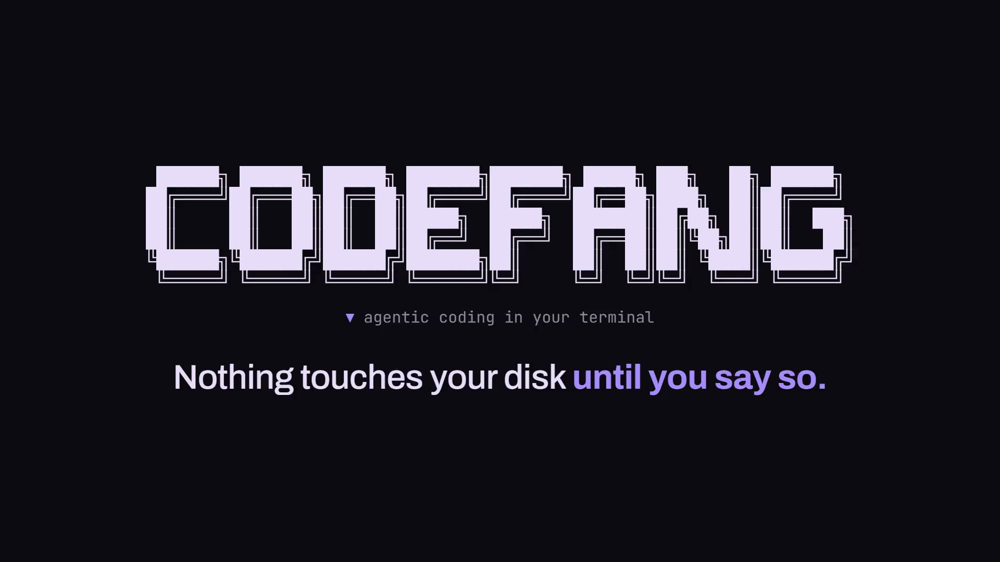

```
 ██████╗ ██████╗ ██████╗ ███████╗███████╗ █████╗ ███╗   ██╗ ██████╗
██╔════╝██╔═══██╗██╔══██╗██╔════╝██╔════╝██╔══██╗████╗  ██║██╔════╝
██║     ██║   ██║██║  ██║█████╗  █████╗  ███████║██╔██╗ ██║██║  ███╗
██║     ██║   ██║██║  ██║██╔══╝  ██╔══╝  ██╔══██║██║╚██╗██║██║   ██║
╚██████╗╚██████╔╝██████╔╝███████╗██║     ██║  ██║██║ ╚████║╚██████╔╝
 ╚═════╝ ╚═════╝ ╚═════╝ ╚══════╝╚═╝     ╚═╝  ╚═╝╚═╝  ╚═══╝ ╚═════╝
```

<p align="center">
  <b>▼ Agentic coding in your terminal — and in your Telegram DMs.</b>
</p>

<p align="center">
  
  
  
  
  
</p>

<p align="center">
  <a href="https://mohitsagar11.github.io/videos/codefang.mp4">
    
  </a>
  <br>
  <sub>▶ 20-second demo (click the image to play) · file: <a href="docs/demo.mp4"><code>docs/demo.mp4</code></a></sub>
</p>

---

## What it is

CodeFang is a coding agent that reads your codebase, plans work, and edits files —
but **nothing it does touches your disk until you say so.**

Every mutation the model makes is written to an in-memory overlay and logged as a
pending action. When the run finishes you get a grouped, colour-coded diff and
decide what lands. Reject, and the staging area is simply thrown away.

```
  model calls modify_file ──▶ overlay (RAM) ──▶ you review the diff ──▶ disk
                                    │
                                    └── reject ──▶ discarded, nothing written
```

The overlay is the source of truth mid-run: a file the agent just staged reads
back as the staged version, and one it staged for deletion reads back as gone —
so it can build on its own work before any of it exists on disk.
That guarantee is [covered by tests](#tests), not just asserted here.

---

## Modes

CodeFang opens with a mode picker. Pick where you want to drive it from.

### ▼ Agent
Give it a task. It explores, stages edits, and hands you a diff to approve.
Up to 40 tool steps.

### ▼ Plan
Give it a goal. It researches the codebase (read-only, plus the web if you have a
Firecrawl key) and returns a structured 1–15 step plan with complexity tags.
Tick the steps you want, and it executes only those — then one approval covers
everything the run staged.

### ▼ Ask
Questions about the codebase, read-only. No file tools are exposed to the model
at all. Optionally save the answer as a Markdown file.

### ▼ Telegram
The same three flows, driven from chat with `/ask`, `/agent`, and `/plan`.
Plans get tappable inline checkboxes; staged changes get **Show Diff**,
**Review one by one**, and **Accept / Reject All** buttons. Locked to a single
owner chat ID.

---

## Quick start

```bash
bun install
cp .env.example .env     # then fill it in (see below)
bun start                # or: bun run index.ts wakeup
```

Once linked (`bun link`), the CLI is available as `codefang`:

```bash
codefang            # banner + mode picker
codefang wakeup     # same thing, explicitly
codefang --help
```

---

## Configuration

Create a `.env` in the project root:

| Variable | Required | Purpose |
| --- | :---: | --- |
| `OPENROUTER_API_KEY` | ✅ | Your [OpenRouter](https://openrouter.ai) key. |
| `OPENROUTER_DEFAULT_MODEL` | ✅ | Model slug exactly as OpenRouter lists it, e.g. `openrouter/auto`. |
| `TELEGRAM_BOT_TOKEN` | Telegram | Bot token from [@BotFather](https://t.me/BotFather). |
| `TELEGRAM_OWNER_ID` | Telegram | Your chat ID. Every other sender is ignored. |
| `FIRECRAWL_API_KEY` | — | Optional. Unlocks the web research tools. |
| `SKILLS_DIRS` | — | Optional. Extra `SKILL.md` roots, `;`-separated. |

---

## Tools

| Tool | Does | Effect |
| --- | --- | --- |
| `read_file` | Read one text file — the staged version if one exists | reads |
| `list_files` | List a directory, optionally recursive | reads |
| `search_files` | Glob match, optional content filter | reads |
| `analyze_codebase` | File and directory counts | reads |
| `list_skills` / `read_skill` | Discover and read `SKILL.md` files | reads |
| `create_file` | New file | **staged** |
| `modify_file` | Full-file replacement | **staged** |
| `delete_file` | Remove a file | **staged** |
| `create_folder` | `mkdir -p` on apply | **staged** |
| `execute_shell` | Queue a command | **staged** |
| `web_search` | Firecrawl search | network |
| `web_crawl` | Scrape a URL to Markdown | network |
| `fetch_url` | Plain HTTP GET | network |

Which modes get what:

| | read | write | shell | web |
| --- | :---: | :---: | :---: | :---: |
| Agent | ✅ | ✅ | ✅ | — |
| Plan (research) | ✅ | — | — | 🔑 |
| Plan (execution) | ✅ | ✅ | ✅ | 🔑 |
| Ask | ✅ | — | — | 🔑 |
| Telegram `/ask` | ✅ | — | — | 🔑 |
| Telegram `/agent`, `/plan` | ✅ | ✅ | ✅ | 🔑 |

🔑 = requires `FIRECRAWL_API_KEY`.

---

## Safety rails

- **Workspace jail** — every path resolves against the project root; `..` escapes throw.
- **Exclusions** — `node_modules`, `.git`, `dist`, `build`, `.next`, `*.log`, and `.env*` are invisible to every tool.
- **Read cap** — files over 1 MB are refused.
- **Nothing is written early** — creates, edits, deletes and folders live in RAM until approved.
- **Shell is queued, not run** — commands only execute after you approve them.
- **Telegram is single-owner** — every update from a chat other than `TELEGRAM_OWNER_ID` is dropped.
- **Skill reads are rooted** — `read_skill` refuses anything outside the configured skill directories.

---

## Tests

```bash
bun test
```

163 tests, nothing to install — Bun's runner is built in. They concentrate on the
places where a bug would be expensive rather than chasing coverage percentages:

| Suite | Covers |
| --- | --- |
| `modes/agent/tool-executor.test.ts` | workspace jail, exclusion policy, staging, apply, shell approval |
| `modes/agent/review-groups.test.ts` | how pending actions collapse into reviewable diffs |
| `modes/agent/action-tracker.test.ts` | the action log and approval bookkeeping |
| `tui/agent-stream.test.ts` | spinner handoff and tool-call rendering |
| `web-demo/server/memory-fs.test.ts` | the virtual repo's path jail (`..`, absolute, drive letters, NUL) and size caps |
| `web-demo/server/playground-overlay.test.ts` | overlay over the virtual repo: nothing lands before review, no disk writes, no shell or skill tools |
| `web-demo/server/api.test.ts` | full SSE runs through the real agent loop (scripted model), review/apply, patch, rate limits, BYOK, model cap |
| `web-demo/server/github.test.ts` | repo URL parsing (SSRF), tar parsing, traversal entries, gzip bombs, size caps |
| `web-demo/server/rate-limit.test.ts` | sliding-window limiter and the daily budget |

The security-critical ones assert exactly what the **Safety rails** below claim:
a path that escapes the workspace never resolves, an excluded path is never read,
and a shell command that was not approved never runs.

---

## Web playground

A public, browser version of the same agent: pick a bundled sample repo (TypeScript,
Python, Go) or a small public GitHub repo, run **Ask**, **Plan** or **Agent**, watch the
run stream live, then approve or reject each file and download a `.patch`.

The overlay idea is what makes this safe to host. Each session gets a **virtual repo held
entirely in memory**; the agent's real tool loop runs against it through the same
`ToolExecutor`, with a `MemoryFS` behind it instead of the disk. Approving a file writes it
to that virtual repo, never to the server.

| Guarantee | How |
| --- | --- |
| No host filesystem | Tools run on `MemoryFS` (`web-demo/server/memory-fs.ts`); skills (which read the host disk) are off |
| No shell | `execute_shell` is never exposed; the executor also refuses to run an approved command on anything but a real disk workspace |
| No SSRF | GitHub import only ever builds a `codeload.github.com` URL from a validated `owner/repo`; `fetch_url` is never exposed; Firecrawl off by default |
| Bounded cost | Per-IP run limits, a daily budget for the shared key, step caps per mode, `maxOutputTokens`, a run timeout, and a server-side model allowlist |
| Bounded memory | Session TTL + caps, repo caps (300 files / 2 MB), per-write and overlay caps, tarball and unpacked-size caps |
| Keys | Visitors may send their own OpenRouter key per request (`x-openrouter-key`); it's never stored or logged, and errors are scrubbed |

### Run it locally

```bash
bun install
bun run web          # dev server with HMR on http://localhost:5175 (uses .env)
bun run web:mock     # same UI, scripted model, no OpenRouter requests
bun run web:build && bun run web:start   # production build on $PORT (default 8788)
```

### Deploy (Docker / Railway)

```bash
docker build -t codefang-web .
docker run --rm -p 8788:8788 --env-file .env codefang-web
```

`.env` is excluded from the image by `.dockerignore`; pass secrets as runtime env vars.
`railway.json` builds the Dockerfile and health-checks `/healthz`. Railway sets `PORT`.

| Variable | Required | Purpose |
| --- | :---: | --- |
| `OPENROUTER_API_KEY` | ✅* | Shared key for visitors without their own. *Without it, visitors must bring a key. |
| `OPENROUTER_DEFAULT_MODEL` | ✅ | Model the shared key runs (always allowed). |
| `PORT` | — | Listen port (default `8788`). |
| `TRUST_PROXY_HOPS` | — | Set to `1` behind Railway's proxy so rate limits use the real client IP. |
| `DEMO_SERVER_MODELS` | — | Extra comma-separated models allowed on the shared key. |
| `DEMO_BYOK_MODELS` | — | Comma-separated models allowed with a visitor's own key (sensible default list). |
| `DEMO_RUNS_PER_WINDOW` / `DEMO_RUNS_PER_WINDOW_BYOK` | — | Runs per IP per window (defaults 6 / 40). |
| `DEMO_RATE_WINDOW_MS` | — | Rate-limit window (default 15 min). |
| `DEMO_DAILY_RUN_BUDGET` | — | Total shared-key runs per UTC day (default 150). |
| `DEMO_MAX_STEPS_AGENT` / `_ASK` / `_PLAN` / `_PLAN_EXEC` | — | Tool-step caps on the shared key (defaults 14 / 8 / 8 / 8). |
| `DEMO_SESSION_TTL_MS` / `DEMO_MAX_SESSIONS` | — | Idle session lifetime (30 min) and global cap (200). |
| `DEMO_GITHUB_IMPORT` | — | `0` disables GitHub import. |
| `DEMO_WEB_TOOLS` + `FIRECRAWL_API_KEY` | — | `1` enables Firecrawl search/crawl in Ask/Plan. Off by default. |

---

## Project layout

```
index.ts                  CLI entry (commander)
ai/                       OpenRouter model factory
tui/
  theme.ts                colours, glyphs, layout helpers — the whole look
  banner.ts               wordmark + context box
  spinner.ts              braille spinner with swappable status labels
  agent-stream.ts         drives the spinner from a live agent stream
  terminal-md.ts          markdown → ANSI
  *.test.ts               stream rendering tests
modes/
  cli.ts                  sub-mode picker
  agent/
    orchestrator.ts       run the agent, then approve
    tool-executor.ts      the staging overlay + all tool implementations
    action-tracker.ts     append-only log of everything the agent did
    review-groups.ts      collapse pending actions into reviewable diffs
    approval.ts           the terminal approval flow
    diff-view.ts          unified patches
    *.test.ts             jail, staging, grouping and approval tests
  plan/                   planner, step selection, web tools
  ask/                    read-only Q&A
  telegram/               bot, handlers, plan and approval sessions
web-demo/
  server/                 Bun.serve API: sessions, SSE runs, review, limits, GitHub import
  app/                    React frontend (landing + playground), bundled by Bun
  samples/                the bundled sample repos
```

---

## Scripts

```bash
bun start          # launch the CLI
bun test           # run the test suite
bun run typecheck  # tsc --noEmit
bun run web        # web playground (dev)
bun run web:build  # build the playground frontend
bun run web:start  # serve the built playground
```
